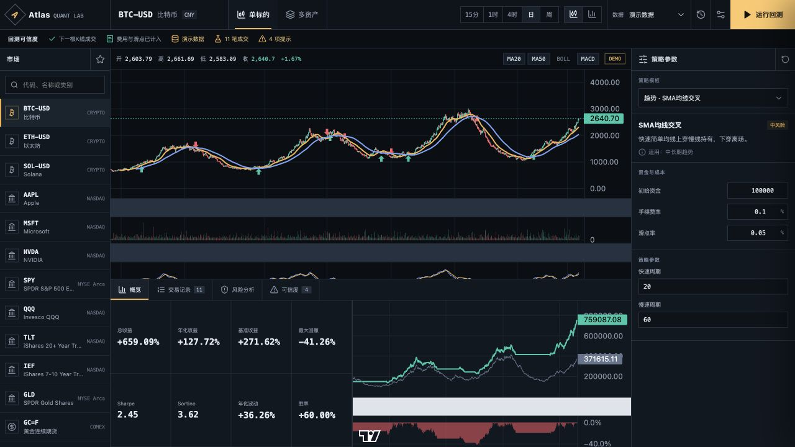
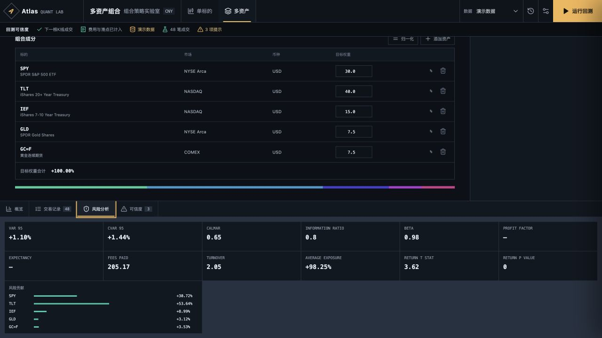

# DeAI Quant Hub · QuantJudge

DeAI Quant Hub 是多用户量化策略研究、历史回测与资产账本平台，代码仓库沿用 Atlas Quant Lab 名称。前端使用 React / TypeScript，业务后端使用 FastAPI / SQLite，完整实验室栈另运行 Supervisor 与 MySQL。

本分支包含本机验收通过的 r23 应用源码，采用浏览器计算和独立行情发布器。更新于 2026-11-09。运行方式、验收结果与既有镜像适用范围见[当前状态](docs/CURRENT_STATUS.md)。

## 文档入口

公开分支包含[完整回测 Proof 优化实验](docs/proof-optimization.md)，包括 guest 源码、构建与验真工具和 500 根 K 线实测。优化 guest 仍用于独立实验，正式登记继续使用原有 v2 验证身份。

| 任务 | 指南 |
| --- | --- |
| 当前已完成与待验 | [统一状态](docs/CURRENT_STATUS.md) |
| 源码运行/分享 | 下方本地启动、[DEPLOY](DEPLOY.md)、[构建前提与持久化](docs/DEPLOYMENT.md) |
| 浏览器计算 | [行情发布、运行租约与作者 Proof](docs/BROWSER_COMPUTE.md) |
| 历史固定镜像交付 | [基础两镜像](docs/LAB_OFFLINE_DEPLOYMENT.md)、[完整四镜像测试链](docs/LAB_CHAIN_DEPLOYMENT.md) |
| 测试 | [隔离浏览器验收](tools/e2e/README.md)、[r23 本机验收](docs/testing/comprehensive-20261108/FOLLOWUP.md) |
| 使用与开发 | [当前工作流](docs/CURRENT_WORKSPACE_WALKTHROUGH.md)、[实验室入门](docs/LAB_QUICKSTART.md)、[策略格式与SDK](docs/STRATEGY_DEVELOPMENT.md) |
| 交易与付费 | [交易环境](docs/TRADING.md)、[BKC与Proof](docs/TRINE_SERVICE_WORKFLOW.md)、[测试账户](docs/TRINE_TEST_ACCOUNTS.md) |
| 评分与证据 | [QuantJudge](docs/QUANTJUDGE.md)、[执行与隐私](docs/EXECUTION_TRUST.md)、[ZKP协议](docs/ZKP.md)、[本地代码到Proof](docs/CODE_TO_PROOF_WALKTHROUGH.md) |
| 结构与产品 | [项目结构](docs/PROJECT_STRUCTURE.md)、[架构](docs/ARCHITECTURE.md)、[产品范围](docs/PRD.md) |

## 公开分支功能

- **行情与回测**：加密货币、A/H股、美股、ETF、指数、外汇和商品，当前A股目录20只；15m/1h/4h/日/周线。提供均线、动量、网格、定投等规则及受限Python单标的回测，另有全天候/风险平价/60-40组合实验。真实源失败明确报错，演示数据需显式选择。
- **成本与风控**：收盘生成信号、下一根开盘成交，费用、滑点、价差、仓位和参与率约束；图表、成交记录与净值使用实际引擎结果。完整A股成交规则和券商接入尚未完成。
- **研究**：普通单策略、组合及参数研究在浏览器 Worker 中执行。支持参数搜索、留出集与滚动验证、样本不足和样本外下降警告。保密订阅版本由受限的 Linux 服务端进程执行。尚无自适应选择补充实验的回测诊断Agent。
- **AI辅助**：自然语言生成/修改代码、预览后人工应用；模板/图形单次回测可选审核。DeepSeek已有真实本地联调，其他提供方和路径需分别验收。AI不改变确定性评分，不自动进入持续运行或实盘下单。
- **策略与评价**：不可变版本、市场发布、具体版本的BKC授权、平台模拟及独立订单/成交/净值记录。统一六维 `evaluation_v1` 保留原始值、规则版本、区间和缺数原因；缺实盘/风格数据时不补零、不生成不完整总分。业绩榜仍用 `performance_score`，证据级别单列。
- **证明与链**：作者在本机生成 Proof，平台按固定 RISC Zero profile 执行真实 receipt 验真，并提供下载和离线复核。完整栈支持测试链签名付款、订阅和版本/Proof 摘要存证。摘要存证不等于链上合约验真，ZKP不证明行情来源或实盘收益。
- **个人账本**：资产/账户/流水、转账、估值、手记、预算、定投记账、OCR核对和JSON备份；按账号隔离，与运行事实记录分别展示。OCR worker/WASM为本站资源，语言模型首次加载可能需要网络。

托管策略使用受限执行。作者侧 Proof 的私有 witness 留在作者设备。真实TEE、zkTLS/DID、任意Python或外部AI推理证明不属于已验收能力。

## 本地启动

### 源码开发

前后端使用两个独立终端。部署锁文件针对Python3.14，源码CI另测3.12；Node需要24–26。

```bash
cd backend
python3.14 -m venv .venv
source .venv/bin/activate
pip install -r requirements.lock
uvicorn app.main:app --reload --port 8000
```

```bash
cd frontend
npm ci
npm run dev
```

访问 `http://127.0.0.1:5173`，Vite同源代理 `/api` 到8000。源码本地允许注册；邮箱仅作登录标识，不发验证邮件。研究无需启动链。首次使用前按[独立行情发布说明](docs/BROWSER_COMPUTE.md#独立行情发布)准备 K 线快照。链付款和存证使用独立测试链及测试资产。

根 `./start.sh` 另需Go、本机MySQL（`/usr/local/mysql/bin/mysqld`）和已安装依赖，创建RPC42519的一次性新链，退出停止本轮进程，不能恢复旧订单。不要与双终端方式重复占用端口。

### Docker

从源码构建先安装[固定 Linux 验证器](docs/DEPLOYMENT.md#构建前置条件)，再在仓库根目录用独立项目启动。

```bash
docker compose -p atlas-browser -f compose.yaml -f compose.browser.yaml build api web
docker compose -p atlas-browser -f compose.yaml -f compose.browser.yaml up -d --no-build --wait --wait-timeout 600
```

本地默认入口为 `http://127.0.0.1:8080`，Web、API 和行情发布器使用独立项目与持久卷。默认配置发布 BTC、ETH 日线。更多标的和周期见[浏览器部署说明](docs/BROWSER_COMPUTE.md)。Supervisor 与 MySQL 通过完整测试链配置加入。既有离线包按对应的[基础镜像](docs/LAB_OFFLINE_DEPLOYMENT.md)和[测试链镜像](docs/LAB_CHAIN_DEPLOYMENT.md)手册使用。

当前 `.env.example`、`.env.lab.example`、`.env.chain.lab.example` 均为无真实凭据模板，demo关闭，测试私钥不内嵌；发布默认关注册，管理员隐藏输入密码创建成员。旧根Dockerfile和单镜像脚本未维护，`deploy/run.sh`已停用。

业务SQLite、缓存与签名/加密密钥保存在业务卷；完整模式还有链state、MySQL及私有链配置，必须整体停写备份。升级保留原项目/卷及创世身份，恢复到独立项目验收；不能靠重建新链恢复原付款。

## 测试与验收

依赖安装后在隔离数据环境执行：

```bash
cd backend && .venv/bin/pytest
cd ../frontend && npm test && npm run lint && npm run build
```

既有源码 CI、完整 Docker、DeepSeek、测试链 Proof 与冷备恢复结果各有对应的版本和环境。本机 r23 的三引擎验收、50 个浏览器会话持续一小时和本机 Docker 更新另行记录。[验收与待验证事项](docs/CURRENT_STATUS.md#已有验收与待验证)

## 运行约束

API 使用单 worker。保密计算按账号限并发，服务端串行执行并限制等待数量。前端和 API 的可信代理按实际环境配置。云模型 Key 仅保存在当前会话内存中，最长 8 小时。

金融指标是带时间戳的快照。单标的 K 线使用原报价币种，多资产组合按基准币种换算。模拟运行随页面心跳续租，租约到期后停止推进。关闭页面期间不会补造模拟成交。[运行与兼容说明](docs/BROWSER_COMPUTE.md#模式接口与兼容)

## 界面预览

以下图片为历史工作台预览，布局和评价以当前代码为准。




