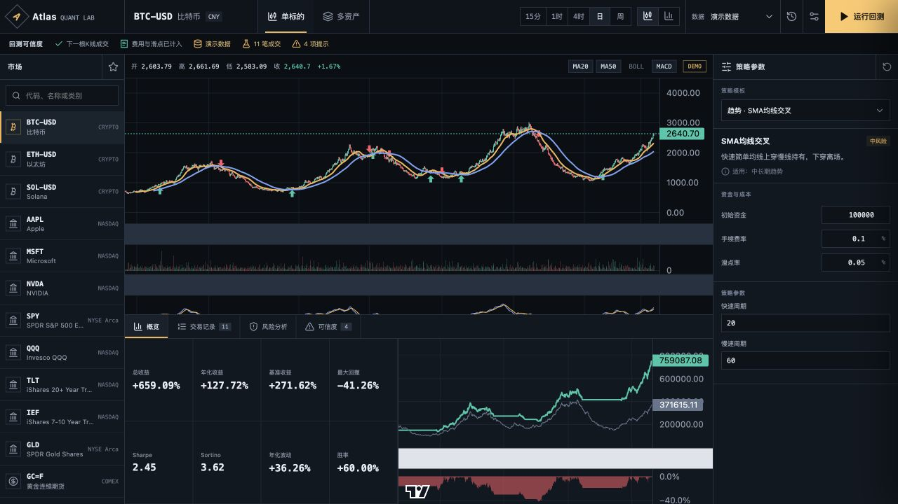
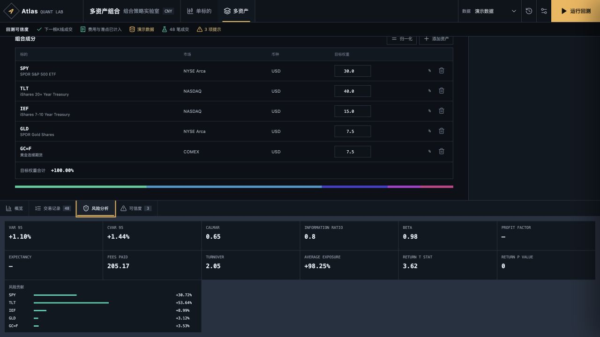

# Atlas Quant Lab · QuantJudge

多用户量化策略研究、历史回测与资产账本平台。前端为React/TypeScript，业务后端为FastAPI/SQLite；完整实验室测试链另运行Supervisor与MySQL。

当前实现基线为 [4be31bf](https://github.com/ashcinder/atlas-quant-lab/commit/4be31bf4a4457829cd5581c0463d198948f09aa9)，文档更新于2026-10-30。各指南与历史记录的适用范围见[当前版本与验收边界](docs/CURRENT_STATUS.md)和[全量文档清单](docs/DOCUMENTATION_SYNC_20261030.md)。本项目用于研究和历史模拟；实盘默认关闭，接口存在不代表真实资金联调完成。

## 文档入口

| 任务 | 指南 |
| --- | --- |
| 当前已完成与待验 | [统一状态](docs/CURRENT_STATUS.md) |
| 源码运行/分享 | 下方本地启动、[DEPLOY](DEPLOY.md)、[构建前提与持久化](docs/DEPLOYMENT.md) |
| 固定镜像交付 | [基础两镜像](docs/LAB_OFFLINE_DEPLOYMENT.md)、[完整四镜像测试链](docs/LAB_CHAIN_DEPLOYMENT.md) |
| 使用与开发 | [当前工作流](docs/CURRENT_WORKSPACE_WALKTHROUGH.md)、[实验室入门](docs/LAB_QUICKSTART.md)、[策略格式与SDK](docs/STRATEGY_DEVELOPMENT.md) |
| 交易与付费 | [交易环境](docs/TRADING.md)、[BKC与Proof](docs/TRINE_SERVICE_WORKFLOW.md)、[测试账户](docs/TRINE_TEST_ACCOUNTS.md) |
| 评分与证据 | [QuantJudge](docs/QUANTJUDGE.md)、[执行与隐私](docs/EXECUTION_TRUST.md)、[ZKP协议](docs/ZKP.md)、[本地代码到Proof](docs/CODE_TO_PROOF_WALKTHROUGH.md) |
| 本科毕设 | [回测诊断Agent选题与验收要求](docs/UNDERGRADUATE_THESIS.md) |
| 结构与产品 | [项目结构](docs/PROJECT_STRUCTURE.md)、[架构](docs/ARCHITECTURE.md)、[产品范围](docs/PRD.md) |

## 已有功能

- **行情与回测**：加密货币、A/H股、美股、ETF、指数、外汇和商品，当前A股目录20只；15m/1h/4h/日/周线。提供均线、动量、网格、定投等规则及受限Python单标的回测，另有全天候/风险平价/60-40组合实验。真实源失败明确报错，演示数据需显式选择。
- **成本与风控**：收盘生成信号、下一根开盘成交，费用、滑点、价差、仓位和参与率约束；图表、成交记录与净值使用实际引擎结果。完整A股成交规则和券商接入尚未完成。
- **研究**：参数搜索、留出集与滚动验证、样本不足和样本外下降警告；浏览器串行穷举与后端异步研究分别管理。尚无自适应选择补充实验的回测诊断Agent。
- **AI辅助**：自然语言生成/修改代码、预览后人工应用；模板/图形单次回测可选审核。DeepSeek已有真实本地联调，其他提供方和路径需分别验收。AI不改变确定性评分，不自动进入持续运行或实盘下单。
- **策略与评价**：不可变版本、市场发布、具体版本的BKC授权、平台模拟及独立订单/成交/净值记录。统一六维 `evaluation_v1` 保留原始值、规则版本、区间和缺数原因；缺实盘/风格数据时不补零、不生成不完整总分。业绩榜仍用 `performance_score`，证据级别单列。
- **证明与链**：固定RISC Zero profile的真实receipt验证、下载、离线复核及受限程序付费生成；完整栈支持测试链签名付款、订阅、版本/Proof摘要存证和原付款恢复。摘要存证不等于链上合约验真，ZKP不证明行情来源或实盘收益。
- **个人账本**：资产/账户/流水、转账、估值、手记、预算、定投记账、OCR核对和JSON备份；按账号隔离，与运行事实记录分别展示。OCR worker/WASM为本站资源，语言模型首次加载可能需要网络。

普通包加密和Docker不能向策略作者保证宿主管理员不可读；服务器生成Proof须明确授权读取程序/witness。真实TEE、zkTLS/DID、任意Python或外部AI推理证明不属于已验收能力。

## 本地启动

### 源码开发

前后端使用两个独立终端。部署锁文件针对Python3.14，源码CI另测3.12；Node需要24–26。

```bash
cd backend
python3.14 -m venv .venv
source .venv/bin/activate
pip install -r requirements.lock
uvicorn app.main:app --reload --port 8000
```

```bash
cd frontend
npm ci
npm run dev
```

访问 `http://127.0.0.1:5173`，Vite同源代理 `/api` 到8000。源码本地允许注册；邮箱仅作登录标识，不发验证邮件。无需先启动链即可研究，链付款/存证需有效持久链及测试资产。

根 `./start.sh` 另需Go、本机MySQL（`/usr/local/mysql/bin/mysqld`）和已安装依赖，创建RPC42519的一次性新链，退出停止本轮进程，不能恢复旧订单。不要与双终端方式重复占用端口。

### Docker

- 从源码构建：先准备[固定Linux验证器](docs/DEPLOYMENT.md#构建前置条件)，审查 `.env.example` 后 `docker compose up --build --detach --wait`；默认回环8080、Web/API两容器。
- 固定镜像接收方：按[离线指南](docs/LAB_OFFLINE_DEPLOYMENT.md)校验和加载镜像，准备受控ENV、HTTPS及管理员账号，再使用预检启动工具，目标机不现场构建。
- 完整测试链：使用四镜像包及[完整链配置](docs/LAB_CHAIN_DEPLOYMENT.md)，API限额6GiB，主机预检至少8GiB可用、建议12GiB以上。RPC/MySQL不暴露宿主端口。

当前 `.env.example`、`.env.lab.example`、`.env.chain.lab.example` 均为无真实凭据模板，demo关闭，测试私钥不内嵌；发布默认关注册，管理员隐藏输入密码创建成员。旧根Dockerfile和单镜像脚本未维护，`deploy/run.sh`已停用。

业务SQLite、缓存与签名/加密密钥保存在业务卷；完整模式还有链state、MySQL及私有链配置，必须整体停写备份。升级保留原项目/卷及创世身份，恢复到独立项目验收；不能靠重建新链恢复原付款。

## 测试与验收

依赖安装后在隔离数据环境执行：

```bash
cd backend && .venv/bin/pytest
cd ../frontend && npm test && npm run lint && npm run build
```

4be31bf已有后端609、前端149及账本63项通过和源码CI成功；本地完整Docker、DeepSeek、测试链新付款/Proof与冷备恢复亦有记录。它们各有独立验收范围，见[统一状态](docs/CURRENT_STATUS.md#已有验收与待验证)。CI不自动构建镜像或验收真实模型/链/TEE。24小时观察及目标服务器原生/HTTPS/成员环境仍需另验，本次文档修订不宣称上线完成。

## 运行约束

API必须单worker；重计算任务共享每账号1项、全局2项预算，超额429。后台研究和Proof生成持有额度至结束，轮询状态不占额度。前端、API代理信任地址需明确配置，HTTPS使用Secure Cookie。云模型Key只在当前会话内存最多8小时，重启需重新配置。

金融指标为当前带时间戳快照，不自动回填历史回测；K线使用原始报价币种，多资产组合另做基准币种换算。研究/提醒/定投依赖后端持续运行，浏览器关闭不等于后端停止。

## 界面预览

以下图片为历史工作台预览，布局和评价以当前代码为准。




